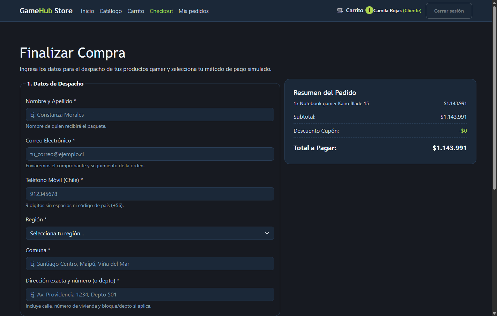
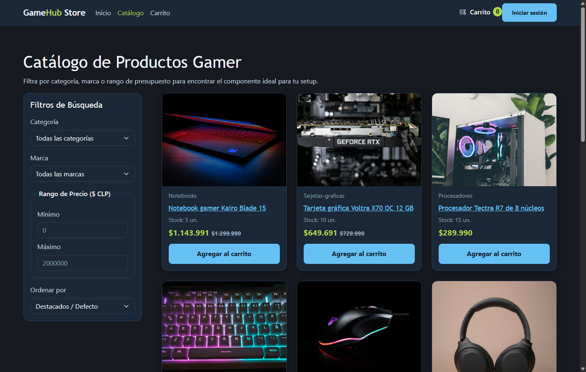
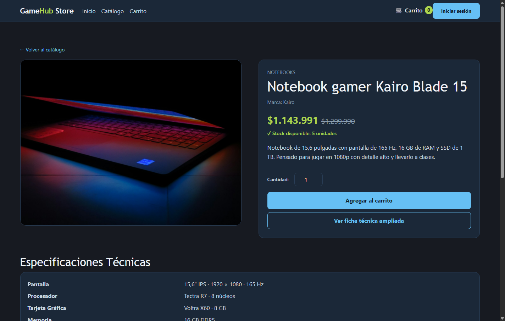
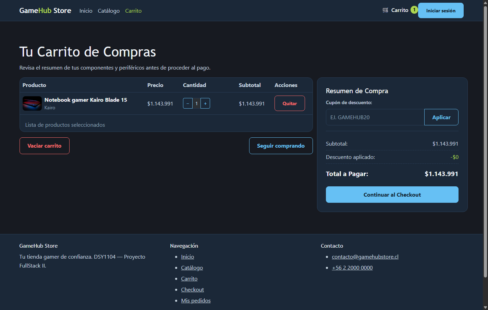
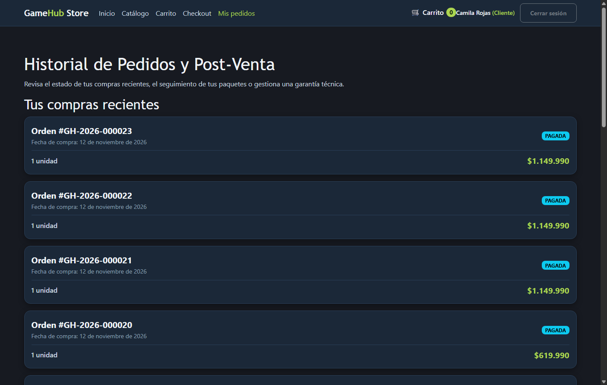
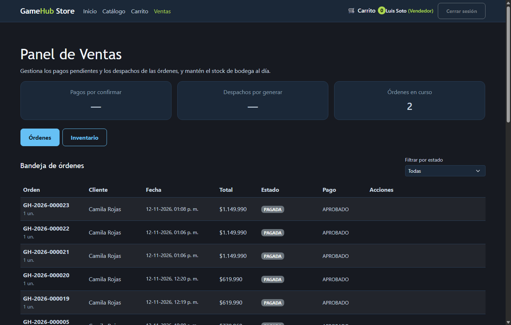
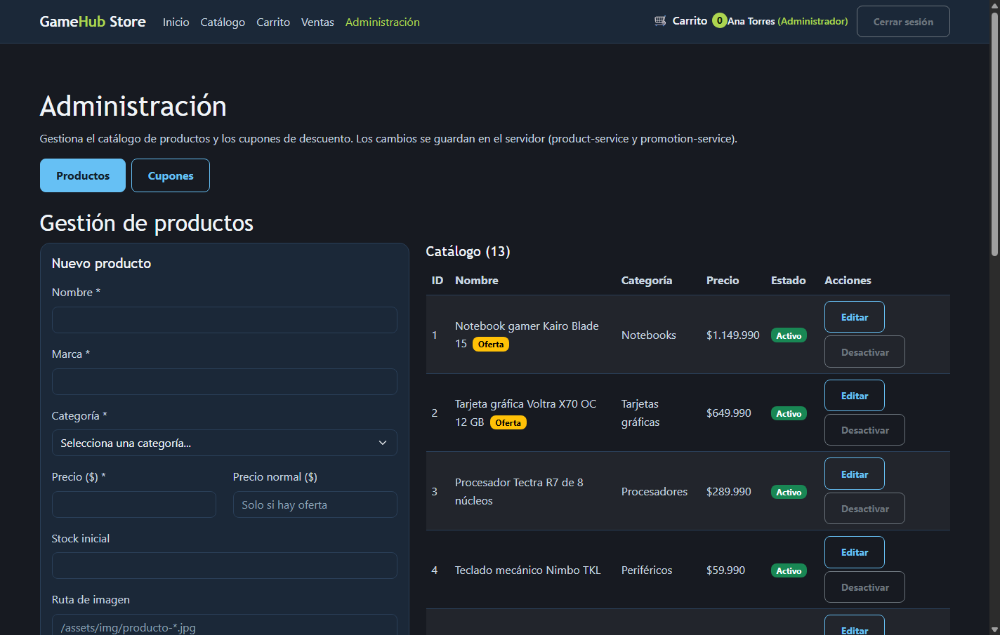
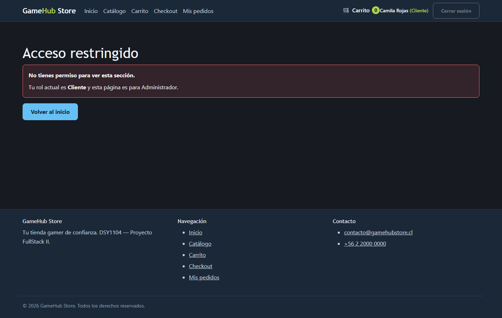

# Manual de Usuario — GameHub Store (EP3)

**Proyecto:** GameHub Store — tienda gamer full-stack
**Asignatura:** DSY1104 Desarrollo Fullstack II — Evaluación Parcial 3
**Fecha:** noviembre de 2026

---

## 1. Qué es GameHub Store

GameHub Store es una tienda en línea de productos gamer (notebooks, tarjetas
gráficas, periféricos, sillas y accesorios). La aplicación tiene tres perfiles:

| Perfil | Qué puede hacer |
|---|---|
| **Visitante / Cliente** | Explorar el catálogo, armar el carrito, registrarse, iniciar sesión, comprar y ver su historial de pedidos. |
| **Vendedor** (`OPERADOR`) | Gestionar los pedidos: confirmar pagos, generar y avanzar despachos, y mantener el inventario. |
| **Administrador** (`ADMIN`) | Todo lo del vendedor, más el mantenedor de productos, categorías, cupones y cuentas. |

La interfaz está en español y muestra los perfiles con su nombre de negocio
(Administrador / Vendedor / Cliente).

---

## 2. Cómo entrar

1. Abre la aplicación en el navegador (`http://localhost:5173` en desarrollo).
2. Pulsa **Iniciar sesión** en la esquina superior derecha.
3. Ingresa tu **correo** y **contraseña**, o usa **Regístrate aquí** para crear
   una cuenta de cliente.

> **Cuentas de prueba** (datos de ejemplo del backend):
> - Administrador — `ana@gamehub.test`
> - Vendedor — `luis@gamehub.test`
> - Cliente — `camila@gamehub.test`
> - Contraseña para todas: `clave123`

Al entrar, la cabecera muestra tu **nombre** y tu **rol**, y el menú se adapta:
un cliente no ve "Administración" ni "Ventas", y un vendedor no ve el checkout.

---

## 3. Explorar el catálogo

El **Catálogo** carga los productos desde el servidor. Puedes filtrar por
**categoría**, **marca** y **rango de precio**, y ordenar por precio o nombre.

El filtro de precio valida que el mínimo no supere al máximo. Cada tarjeta
muestra el stock real y el precio con su descuento (si lo tiene).

---

## 4. Ver la ficha de un producto

Al pulsar el nombre de un producto se abre su **ficha**: imagen, precios,
stock, especificaciones técnicas y **reseñas reales** de otros clientes (solo
las aprobadas por el administrador).

Elige la cantidad (no puede superar el stock) y pulsa **Agregar al carrito**.

---

## 5. El carrito y los cupones

El **Carrito** conserva lo que agregaste incluso si cierras el navegador.
Puedes cambiar cantidades, quitar líneas o vaciarlo.

En **Cupón de descuento** escribe un código y pulsa **Aplicar**: el cupón se
valida contra el servidor y el descuento se refleja en el resumen. Un código
inválido o vencido se avisa sin romper la compra.

---

## 6. Finalizar la compra

El **Checkout** pide los datos de despacho y el medio de pago simulado. Los
campos se validan en vivo (nombre completo, correo, teléfono chileno, etc.).

Al pulsar **Confirmar y Pagar Orden**, la compra se registra de verdad en el
backend: se crea la orden, se registra el pago y se descuenta el stock. El
sistema muestra el **número de orden** y el **estado del pago** reales.

> Esta sección solo está disponible para usuarios con sesión de **Cliente**.

---

## 7. Mis pedidos

En **Mis pedidos** ves el historial real de tus compras con su estado (pagada,
en tránsito, entregada, etc.) y el total de cada una. También está el formulario
de **Solicitud de Garantía Técnica** para productos con fallas.

---

## 8. Panel del Vendedor

Los usuarios con rol **Vendedor** (o Administrador) ven **Ventas** en el menú.
El panel tiene dos pestañas:

**Órdenes:** la bandeja con las órdenes de la tienda. Desde aquí el vendedor
- confirma un pago pendiente (una transferencia, por ejemplo) o lo anula;
- genera el despacho y lo avanza: *despachado → en tránsito → entregado*.

**Inventario:** el stock actual por producto y el registro de movimientos de
bodega (ingreso, salida o ajuste).

---

## 9. Panel del Administrador

Los usuarios **Administrador** ven **Administración** en el menú. Tiene dos
pestañas: **Productos** y **Cupones**.

- **Productos:** crear, editar, activar o desactivar un producto del catálogo.
  Al guardar, el cambio queda en el servidor y se refleja en la tienda.
- **Cupones:** crear y activar/desactivar promociones de descuento, con su
  porcentaje, tope y vigencia.

---

## 10. Accesos restringidos

Si intentas abrir una sección para la que tu rol no alcanza, la aplicación te lo
indica en el lugar (sin llevarte a otra página) y te ofrece volver al inicio.
Además, el servidor rechaza cualquier petición no autorizada, así que la
protección no depende solo de la interfaz.

---

## 11. Preguntas frecuentes

**¿Por qué no veo "Administración"?** Tu cuenta no tiene ese rol. El menú se
filtra según tu perfil.

**No me deja cerrar la compra.** El checkout exige haber iniciado sesión como
Cliente y tener productos en el carrito.

**El cupón no se aplica.** Puede estar vencido, agotado o no existir; el mensaje
del servidor te dirá el motivo.

**Mis cambios en el mantenedor no se ven en la tienda.** Recarga el catálogo:
los cambios se guardan en el servidor y se reflejan en la próxima consulta.
